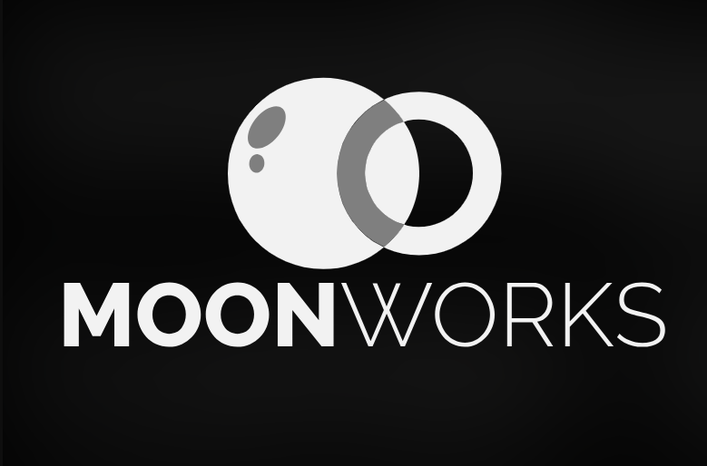

  

<h1 align="center">Moonworks Frontier Swarm Intelligence</h1>

 Hello World! Moonworks is training a swarm of models across vision, audio and text to push the frontier of intelligence. 

  
  
  

---

## 📢 Moonworks Lunara: Modeling Artistic Intelligence

Paper:  https://arxiv.org/pdf/2609.22272

Eval Dataset: https://huggingface.co/datasets/moonworks/lunara-art-eval

## 📢 Lunara Open Source Data Release – Part 2

Dataset: https://huggingface.co/datasets/moonworks/lunara-aesthetic-image-variations

Paper: https://arxiv.org/pdf/2602.01666

## 📢 Lunara Open Source Data Release – Part 1

Dataset: https://huggingface.co/datasets/moonworks/lunara-aesthetic

Paper: https://arxiv.org/abs/2601.07941

## 🔗 Links
- Website: https://moonworks.ai/  
- MoonAI: https://moonworks.ai/moonai  
- Moonstone Agent: https://moonworks.ai/agents  
---

  © {YEAR} Moonworks. All rights reserved.

